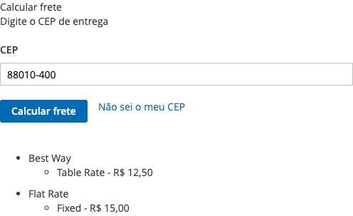
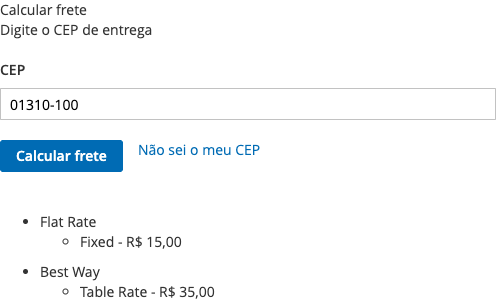
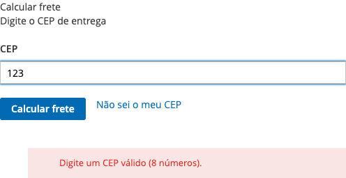

# Shipping Estimate on the Product Page (Brazil) for Magento 2

[](https://github.com/roneclay/m2-estimate-shipping-brazil/actions/workflows/ci.yml)

Lets the shopper type a Brazilian postcode (**CEP**) on the product page and see **every shipping method** the store
would offer for that product, with its price, before adding anything to the cart.

## The problem it solves

Brazilian shoppers are used to checking the shipping cost with nothing but a CEP, on the product page. Magento only
estimates shipping inside the cart or the checkout, after the product was added and an address was typed.

This module runs the same rate collection as the checkout, for the product on the page and the chosen options and
quantity, and lists the result grouped by carrier. It does not need a quote or a customer: it works for guests, and
it uses whatever carriers the store has enabled (Table Rate, Flat Rate, Correios integrations, ...).

## Features

- Postcode field with the `00000-000` mask, validation, and Enter key support.
- Lists **all** carriers and methods with their prices (in the display currency) and carrier messages.
- Works with simple, configurable and bundle products: the chosen options and the quantity are part of the estimate.
- Rates that depend on the cart data are right: the address totals are collected, so Table Rate by weight sees the
  real weight (6 items of 1 kg fall in the "5 kg and more" tier).
- Errors are reported as JSON (`{"error": {"message": "..."}}`) with a proper HTTP status, and shown to the shopper.
- All text is inserted as text, never as HTML. Translated to English and Brazilian Portuguese.
- Link to the Correios postcode lookup for shoppers who do not know their CEP.

## Compatibility

| | |
|---|---|
| Declared | Magento Open Source / Adobe Commerce **2.4.7+** (`magento/framework` `^103.0.7`), PHP **8.2 – 8.3** |
| Tested end-to-end | Magento Open Source **2.4.8-p4**, PHP 8.3, MariaDB 10.6, OpenSearch 2.12, Luma theme with the sample data, `pt_BR` / BRL, Flat Rate and Table Rate |
| CI | phpcs (Magento2 standard), phpstan level 9 and PHPUnit on PHP 8.2 and 8.3 |

The destination country is fixed to Brazil. Other themes may need CSS adjustments.

## Installation

The module is installed straight from this repository with Composer:

```bash
composer config repositories.fineweb-simulate-product-shipping vcs https://github.com/roneclay/m2-estimate-shipping-brazil
composer require fineweb/module-simulateproductshipping:^1.0

bin/magento module:enable Fineweb_SimulateProductShipping
bin/magento setup:upgrade
bin/magento setup:di:compile                  # production mode only
bin/magento setup:static-content:deploy -f    # production mode only
bin/magento cache:flush
```

## Configuration

There is no setting of its own: the estimate uses the store's shipping configuration.

- `Stores > Configuration > Sales > Shipping Settings > Origin`: set the origin (country, region, postcode).
- `Stores > Configuration > Sales > Delivery Methods`: enable the carriers you want to show (Flat Rate, Table Rate,
  Correios or any other carrier module). A carrier that is not enabled, or does not ship to Brazil, is not listed.
- The block is rendered in the product page's main column, after the add-to-cart form. To move it, override the layout
  of `catalog_product_view` and change the container of `product.info.shipping`.

### The endpoint

`POST /fineweb/simulate/index` receives the product form (the same fields as add-to-cart: `product`, `qty`,
`super_attribute`, `bundle_option`, ...) plus `simulate[postcode]`. It answers with

```json
{ "Flat Rate": [{ "title": "Fixed", "price": "R$ 15,00", "message": "" }],
  "Best Way":  [{ "title": "Table Rate", "price": "R$ 12,50", "message": "" }] }
```

or, with HTTP 400 / 500, `{ "error": { "message": "Please enter a valid postcode (8 digits)." } }`.

## Screenshots

| | |
|---|---|
|  |  |
| A simple product: both carriers, with the table rate for that postcode. | A configurable product with the options chosen. |
|  |  |
| 6 items of 1 kg reach the 5 kg tier of the Table Rate (R$ 35,00). | A bundle product. |
|  | |
| An incomplete postcode. | |

They were captured by the end-to-end tests, so they show what the module renders.

## Development

```bash
# original Magento packages from a public mirror, no repo.magento.com keys needed
composer config -g repositories.magento-mirror composer https://mirror.mage-os.org/
composer install
composer check        # phpcs + phpstan + PHPUnit
```

The `e2e/` folder has the Playwright tests that run against a store with the module installed; see `e2e/README.md`.

## License

[GPL-3.0-or-later](LICENSE) © Fineweb
